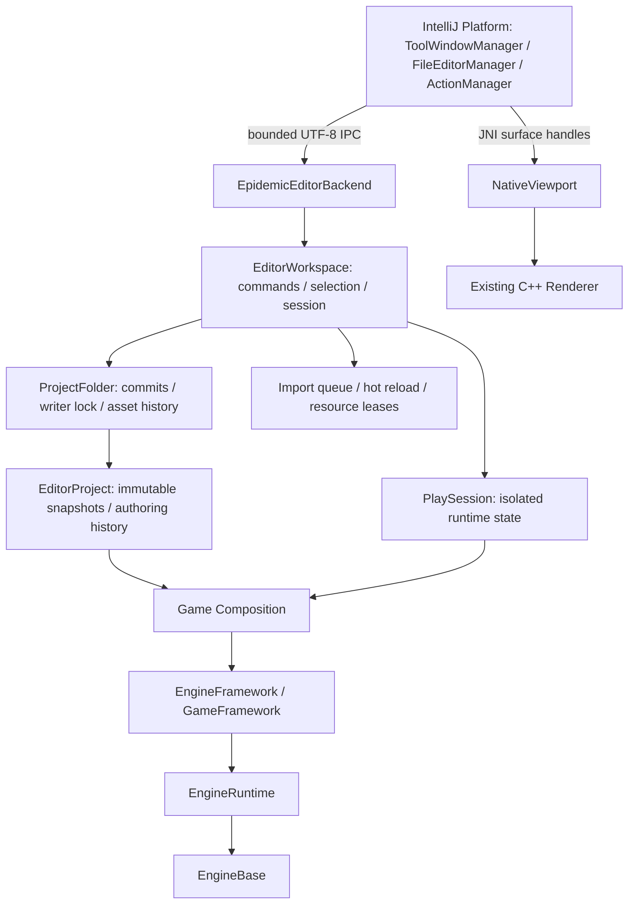

# Editor architecture

Sources: `Temp/!Tasks/UI_Roadmap.md`, owner contract revision 2026-11-05. IntelliJ Platform is the sole target Editor UI. C++23 remains the engine and authoritative editor backend. U acceptance does not imply F feature parity.

## Ownership

One PlatformSession owns one Bridge/native Workspace. All documents, tools and independent Windows windows share it; detachment creates no second project, history, asset registry, Scene or VM. Tool Windows may move as whole groups under the accepted U contract; central documents may detach individually. Focus, selected tabs and scroll belong to views, not the domain selection service.

The empty Platform host container and UI preferences live outside game projects. `.idea` is never game metadata. Game watching and source/cooked publication remain native responsibilities. Game files are not indexed as an IDE software project.

## Boundaries

| Concern | Authoritative owner / rule |
|---|---|
| Project envelope / revisions / locks | ProjectFolder; one native writer, committed authoring/source identities. |
| Scene / Prefab / Graph authoring | EditorProject immutable snapshots; validated Execute requests with stable typed IDs. |
| Undo / Redo | Existing folder-wide history including document/file changes; no JVM history copy. |
| Selection | EditorWorkspace / UiSelection; no HWND, tree-item or object-pointer identities. |
| Play | Existing PlaySession; runtime and authoring lifetimes remain separate. |
| Assets / jobs | Existing Resources, import queue, watcher and last-good generation leases. |
| Geometry / Inspector projections | Reused SceneView, SceneDrag and Inspector builders; no mutable domain model in controls. |
| Native GPU surface | JNI NativeViewport; EDT/thread-owned HWND and Renderer lifetime; release before peer destruction. |
| UI layout / commands | Platform services and product preferences; never persisted as game authoring. |

IPC uses correlation IDs, connection generation and expected authoring revision, bounded frames/strings/queue and explicit capabilities. I/O and native operations stay off EDT; replies publish immutable snapshots on EDT. Reconnect replaces only the companion and preserves the shell's views. Planned actions remain disabled and centrally rejected before publication.

## Product composition and lifecycle

Own EXE → own launcher Main → public Platform bootstrap → EpidemicStarter → PlatformSession. Platform 253.31033.145 is assembled from 353 coordinate/SHA-locked public artifacts. Compiler is Microsoft OpenJDK 21.0.7; default bundled runtime is independently downloaded public vanilla JBR 21.0.10+1-b1163.108 with pinned publisher SHA512. No installed IDEA product/runtime is a packaging source. Optional installed-SDK development tooling uses the same Platform UI, not another shell.

The pinned DirectoryLock correction recognizes only the immediate native jpackage parent as part of this launch. Genuine owners retain activation/competition protection. Windows uses upstream TCP profile locking and disposable `system-tcp-v1`; config/container/preferences persist and old AF_UNIX files remain untouched. Owner diagnostics are written only after profile lock acquisition.

File selection goes through Platform FileChooser and its modality/focus integration. JBR supplies the supported Windows native chooser; `-StandardOpenJdk` is a diagnostic fallback. Shared actions own Save/Undo/Redo shortcuts on main/document roots and respect editable text focus.

## Native source boundaries after L0

`Game/Editor/src` and `include` retain Editor Core, serializers, ProjectFolder, assets and Play. `Game/Editor/ui/src` and its headers retain the reusable session/projection adapters; the `EpidemicEditorUi` static library is not a standalone UI. Semantic Workspace/Inspector/SceneView/stress tests remain. Retired Win32 windows, Content Browser dialog, native control chrome and desktop executable are removed without deleting engine functionality.

The preserved native surface adapter belongs in `tools/editor-ui-host`; no competing custom dock owner is required. Exact deletion inventory, retained dependencies and test replacements are in `UI_MIGRATION_MAP.md`. Actual U/L0/F status and test results are in `UI_QA_MATRIX.md`; future functional wiring is tracked in `UI_FEATURE_MIGRATION_BACKLOG.md`.
