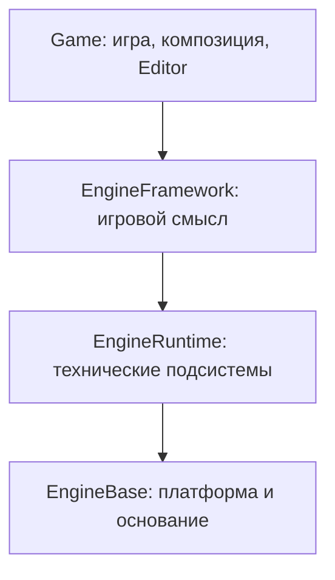

# Epidemic Engine — руководство по устройству и использованию

Это практическое руководство по текущей ветке `v2`: где находится нужная подсистема,
как собрать движок, попробовать редактор и добавить собственную игровую логику.
Примеры ниже рассчитаны на Windows и запуск PowerShell из корня репозитория.
Промежуточные файлы, сборки и результаты примеров размещаются в `Temp`.

Название программы развития «Epidemic 2.0» не означает новую версию установленного
SDK: в текущем `CMakeLists.txt` версия проекта/пакета — `1.1.0`.
Контракты API проверяйте по текущим публичным заголовкам; документы о прежних
ветках и отдельной игре ASCENT могут описывать другой порядок запуска.

## Содержание

- [1. С чего начать](#start)
- [2. Как устроен движок](#architecture)
- [3. Основные понятия](#concepts)
- [4. Сборка и запуск примеров](#build)
- [5. Как пользоваться Editor UI](#editor)
- [6. Как добавить свою игровую систему](#gameplay)
- [7. Как работают графы](#graphs)
- [8. Данные, ресурсы и сохранение](#data)
- [9. Время, жизненный цикл и остановка](#lifetime)
- [10. C#, SDK и WebAssembly](#platforms)
- [11. Проверки и Auditor](#checks)
- [12. Частые проблемы](#problems)
- [13. Куда вносить изменения и что читать дальше](#navigation)

<a id="start"></a>
## 1. С чего начать

**Хочу посмотреть, что уже работает.** Соберите `EpidemicEditorChecks`, запустите
`EpidemicEditorDesktop` и выполните сценарий из раздела 5.

**Хочу написать игровую механику.** Начните с `Game/Composition/example/vertical_slice.cpp`:
там есть Enemy с Health/Movement, Prefab, собственные операции и WaveDirector.
Затем посмотрите `Game/Editor/example/headless.cpp`, где данные создаются через команды,
сохраняются, открываются новым процессом и запускаются.

**Хочу изменить техническую подсистему.** Найдите её владельца в следующем разделе.
Например, компилятор графов относится к Runtime, а правила нанесения урона — к игре.

**Хочу подключить движок к отдельному приложению.** Используйте установленный CMake SDK
и `Examples/MinimalGame`. Этот маршрут описан в разделе 10.

<a id="architecture"></a>
## 2. Как устроен движок

Разрешённое направление зависимостей:



Стрелки показывают направление зависимостей. Верхний слой может использовать
разрешённые нижние контракты. Нижний слой не знает о верхнем. Диаграмма показывает
порядок слоёв; она не разрешает произвольные связи между всеми их модулями.

### EngineBase — основание приложения

| Каталог | Ответственность |
|---|---|
| `Foundation` | Общие типы, идентификаторы, `Result` и ошибки. |
| `Memory` | Базовые механизмы работы с памятью. |
| `Core` | Microkernel, сервисы и жизненный цикл приложения. |
| `Platform` | Платформенные операции, окна, файловый ввод-вывод, библиотеки. |
| `Input` | Низкоуровневый ввод. Значение «атака» или «открыть инвентарь» задаётся выше. |
| `RHI`, `RHI_D3D11`, `RHI_WebGL` | Низкоуровневые графические контракты и платформенные реализации. |
| `Diagnostics`, `Support` | Диагностика и предусмотренная композиция базовых механизмов. |
| `Apps`, `Tests` | Небольшие проверочные приложения и тесты основания. |

Здесь создаётся окно, но не определяется Enemy, Health или сценарий волн.

### EngineRuntime — технические механизмы

| Подсистема | Для чего нужна |
|---|---|
| `RuntimeFoundation` | Общие Runtime-типы, время, пространственные значения и идентификаторы. |
| `Assets` | Каталог авторских assets, их расположение, ссылки и зависимости. |
| `Resources` | Загрузка и удержание данных в памяти, leases, handles, бюджеты и eviction. |
| `Serialization` | Типизированное представление данных, кодирование и проверка схем. |
| `Persistence` | Контракты технического сохранения и восстановления данных. |
| `Schema` | Описание и привязка native-вызовов; это не игровой Entity Registry. |
| `Graph` | Определения графов, проверка, компиляция в IR и выполнение экземпляров. |
| `Time`, `Simulation` | Игровые часы и организация технических заданий симуляции. |
| `Scene`, `World`, `Streaming` | Пространственное состояние, организация мира и управление его загрузкой. |
| `Renderer`, `Physics`, `Navigation` | Отрисовка, физические и навигационные механизмы. |
| `Animation`, `Audio`, `Environment` | Технические сервисы анимации, звука и окружения. |
| `Support` | Адаптеры и композиция независимых Runtime-подсистем, включая GraphScheduler. |

Наличие подсистемы не означает готовый игровой workflow для любого проекта.
Публичные контракты, поддерживаемые реализации и ограничения смотрите в её headers и тестах.

Runtime majors независимы: нельзя добавить прямую зависимость `Graph → Time`
или `Physics → Scene` только ради удобства. Их связь собирается разрешённым
адаптером в `EngineRuntime/Support` или верхним composition root.

### EngineFramework / GameFramework — игровой смысл

| Группа | Назначение |
|---|---|
| `BaseInfrastructure` | Общие игровые типы, Facts, Queries, игровое время и случайность. |
| `GameplayWorldStateOwners/Entities` | Единственный владелец Entity, Parts и их lifecycle. |
| Остальные `GameplayWorldStateOwners` | Доменные сервисы: бой, способности, предметы, экономика, AI, диалоги, потребности, мир и другие игровые состояния. |
| `GameplayWorldStateOwners/SaveGame` | Сохранение игрового состояния через предусмотренные участники и контракты. |
| `IntegrationLayer/Integration` | Универсальные компоненты, свойства, GraphBehavior, Prefab и lifetime scopes. |
| Остальные `IntegrationLayer` | Явная связь доменных сервисов; `Session` помогает собирать игровой сеанс. |
| `RuntimeBoundary/RuntimeBridge` | Связь игрового объекта с его техническим представлением в Runtime. |
| `RuntimeBoundary/Presentation` | Контракты представления игры, включая существующие 2D/UI-механизмы. |
| `DevelopmentInfrastructure` | Проверки и CMake-инфраструктура Framework. |

`Facts` и `Queries` относятся к инфраструктуре работы с игровыми сведениями
и запросами. Они не заменяют владельцев конкретного состояния. Например, данные
инвентаря остаются у сервиса инвентаря, а identity Entity — у EntityService.

### Game — место сборки конкретного приложения

`Game/Composition` связывает Framework с техническим выполнением графов и сцен.
Здесь `GraphExecutionHost` предоставляет графу игровой контекст и делегирует
компиляцию, VM и ожидания в Runtime.

`Game/Editor` содержит Editor Core, headless-пример, portable-контроллер UI и
нативное Windows-окно. Редактор работает с существующими определениями Scene,
Prefab и Graph. Он не создаёт собственную независимую модель Entity или Assets.

Конкретные правила вашей игры, её native-операции, регистрации типов и контент
должны собираться на уровне приложения. Для добавления `Health` не требуется
встраивать поле здоровья в ядро движка.

<a id="concepts"></a>
## 3. Основные понятия

| Понятие | Что означает |
|---|---|
| Asset | Авторское определение с устойчивым `AssetId`. Путь и отображаемое имя могут меняться. |
| Resource | Загруженное Runtime-представление данных с собственным временем жизни. |
| Entity | Игровая identity и lifecycle в существующем EntityService. |
| Part | Часть существующей Entity; не отдельная параллельная система identity. |
| Component | Типизированное состояние, присоединённое к Entity/Part, например Health. |
| Prefab | Определение объектов, компонентов, поведений и параметров для создания экземпляров. |
| Scene | Авторское пространственное размещение и ссылки на Prefab; не список живых VM. |
| GraphDefinition | Авторские узлы, порты, соединения и их ID. |
| CompiledGraph | Неизменяемая программа IR текущего процесса после привязки операций. |
| Activation / GraphInstance | Один запуск программы: свои значения, позиция исполнения и состояние. |
| GraphBehavior | Привязка графа, событий и входов к объекту с определённым lifetime. |
| SystemInstance | Самостоятельная Scene/World-система, например WaveDirector, без искусственной Entity. |
| Authoring | Данные, которые редактирует и сохраняет разработчик. |
| Runtime state | Состояние работающей игры: текущее здоровье, активные ожидания и прочее. |

Один Prefab и один граф могут использоваться многими экземплярами. Их определения
разделяются; изменяемое состояние компонентов и активаций должно быть независимым.

<a id="build"></a>
## 4. Сборка и запуск примеров

Нужны установленный C++ toolchain с поддержкой C++23, Windows SDK, CMake и PowerShell.
Часть проверок использует Python. Обычная C++-сборка не требует CLR/.NET.
Штатный `Invoke-Dev.ps1` сейчас выбирает generator `Visual Studio 18 2026`, x64;
это следует учитывать при переносе рабочего окружения.

Не переустанавливайте уже работающие инструменты ради запуска примера.
У существующего build-каталога сохраняются его CMake-настройки. Не применяйте
`-Clean` к нему без необходимости: этот параметр удаляет выбранный каталог сборки.

### Минимальный путь к редактору

```powershell
& .\Development\AgentsRules\Scripts\Invoke-Dev.ps1 `
  -Action Build -Profile full -Configuration Debug `
  -BuildDirectory Temp/b/w64 -RuntimeDirectory Temp `
  -Target EpidemicEditorChecks -BuildJobs 2 -ShortOutput

& .\Temp\b\w64\Game\Editor\ui\Debug\EpidemicEditorDesktop.exe
```

`EpidemicEditorChecks` собирает Editor и связанные проверочные executable;
действие `Build` само тесты не запускает. Для этого используется `Test` из раздела 11.
Пути executable выше соответствуют Visual Studio generator; у Ninja структура иная.

Профили сборки: `base` — EngineBase; `runtime` — Base и Runtime; `full` — также
Framework и текущие Game-цели. Для Editor нужен `full`.

### Проверка сохранения без UI

```powershell
& .\Temp\b\w64\Game\Editor\Debug\EpidemicEditorHeadless.exe `
  --write Temp/editor-guide/example.epidemic

& .\Temp\b\w64\Game\Editor\Debug\EpidemicEditorHeadless.exe `
  --read-play Temp/editor-guide/example.epidemic
```

Это два отдельных процесса. Первый создаёт документы командами, соединяет граф,
проверяет Undo/Redo и сохраняет архив. Второй открывает файл, создаёт игровую
сессию, проверяет Damage/Wait/resume и Stop. Успех каждого отмечается `PASS`.

### Игровой вертикальный срез с системой волн

```powershell
& .\Development\AgentsRules\Scripts\Invoke-Dev.ps1 `
  -Action Build -Profile full -Configuration Debug `
  -BuildDirectory Temp/b/w64 -RuntimeDirectory Temp `
  -Target EpidemicCompositionExample -BuildJobs 2 -ShortOutput

& .\Temp\b\w64\Game\Composition\Debug\EpidemicCompositionExample.exe
```

Это headless-пример игровой композиции. WaveDirector использует
Event/Branch/Repeat/native Spawn/Wait, создаёт врагов из Prefab и проверяет
независимость их состояния и отмену исполнения при уничтожении владельца.

<a id="editor"></a>
## 5. Как пользоваться Editor UI

Текущий UI — минимальный Windows host со стандартными контролами.
Он предназначен для работы с данными и проверки поведения; пространственного
viewport и графического canvas с перетаскиванием узлов пока нет.

### Первый сеанс

1. Нажмите **New example**, выберите путь, например `Temp/editor-guide/ui.epidemic`.
   Будут созданы Scene, Enemy Prefab и граф Enemy behavior.
2. В дереве раскройте **Prefab / Enemy** и выберите вложенную **Entity**.
   В свойствах появятся Health/points и Movement/speed, enabled, label.
3. Выберите свойство, измените значение в поле **Value** и нажмите **Apply**.
   Например, задайте Health/points = `150`. Изменённые документы отмечаются `*`.
4. Проверьте **Undo** и **Redo**. Нажмите **Save**.
5. В Scene выберите **Placement 42**, нажмите **Play**, затем **Send hit**.
   Поле Payload по умолчанию равно `10`: оно используется как величина урона
   и как длительность ожидания в игровых ticks.
6. Внизу наблюдайте активацию: она выполняет Damage, ждёт и выполняет Damage again.
   Терминальный отчёт показывает статус, инструкции и native calls; при ошибке — диагностику.
7. Нажмите **Stop**. Авторское Health/points останется `150`.
   Изменения здоровья во время Play принадлежат отдельному игровому экземпляру.
8. Закройте и снова откройте файл через **Open** для проверки сохранённых данных.

В данном графе при исходном здоровье 150 и payload 10 runtime-здоровье становится
140, затем 130. Отдельного live-инспектора runtime-компонентов в UI пока нет;
точные значения проверяются программно, как в headless-примере.

### Документы и связи

- **+ Scene / + Prefab / + Graph** создают документы через Command API.
- **Add item / Delete item** действуют в контексте выбранного документа/элемента.
  Удаление, нарушающее обязательные ссылки, отклоняется с ошибкой.
- В Scene выберите placement и используйте **Assign Prefab**.
- В Prefab доступны свойства зарегистрированных компонентов, **Add Health**,
  **Add Movement** и назначение GraphBehavior. Повторное добавление существующего
  компонента не сбрасывает его значения.
- Для Graph выберите шаблон Event entry, Native damage или Wait и нажмите **Add item**.
  Выберите Output/Input port и **Connect ports**. Проверка типов выполняется в Core.
  Для удаления соединения выберите его строку Link и **Delete item**.
- **Assign hit GraphBehavior** связывает выбранный Graph asset с событием `hit`
  через первый входной event-порт. Необходимую форму графа проверит Play.

### Черновики, сохранение и клавиши

Изменение текста поля ещё не меняет документ. **Apply / Enter** публикует команду;
**Revert field / Escape** сбрасывает черновик поля. Перед сменой выделения нужно
применить или отменить поле. Некорректное число, NaN/Infinity и недопустимое
игровое значение отклоняются без изменения истории и точки сохранения.

**Save** сначала применяет корректный черновик. Закрытие и замена несохранённого
проекта предлагают Save/Discard/Cancel. **Ctrl+S/O/N** — Save/Open/New example;
**F5 / Shift+F5** — Play/Stop. **Ctrl+Z/Y** вне поля Value управляют историей проекта;
Ctrl+Z внутри Value остаётся обычным откатом текста.

### Границы текущего UI

Host знает схему игрового примера. Для собственных типов нужны их регистрации
и привязки операций в host; неизвестный компонент нельзя добавить одним названием.
Параметры и связанные с ними свойства read-only, UI редактирования overrides отсутствует.
Повторное назначение того же Prefab сохраняет его overrides.

Play использует `ProjectDefinition::entry_scene`, а не любой выделенный Scene-документ.
Переключателя entry Scene в UI пока нет; в Command API есть `SetEntryScene`.
Изменения authoring во время Play видны следующей сессии. Preview-таймер продвигает
один игровой tick примерно раз в 33 мс; это не универсальное правило времени игры.

<a id="gameplay"></a>
## 6. Как добавить свою игровую систему

### Компонент

Определите обычную C++-структуру и зарегистрируйте её свойства в существующем
`ComponentRegistry`. Пример схемы регистрации:

```cpp
struct Health { std::int64_t points = 100; };

// registry — gameplay::composition::ComponentRegistry.
auto health = registry.Register<Health>("mygame.health");
// После успешного health:
auto points = registry.RegisterProperty(health.Value(), "points", &Health::points);
// Проверьте points; после регистрации всех типов и свойств:
registry.Freeze();
```

Это фрагмент регистрации, а не самостоятельная программа. Каждый `Result`
необходимо проверить до `Value()`. Числовые ограничения задаются валидатором
свойства; пример с ним находится в `Game/Editor/example/demo_game.h`.
Поддерживаемые типы свойств: `int64_t`, `double`, `bool`, `std::string`.

Archetype регистрируется в существующем EntityService отдельно. Затем
`ComponentStore` присоединяет свежие экземпляры компонентов к EntityHandle/Part.
Не создавайте ещё один EntityService ради универсальных компонентов.

### Поведение и native-операция

1. Опишите `GraphDefinition` со стабильными ID узлов и портов.
2. Сопоставьте типы узлов с поддерживаемыми `Operation` и явными native bindings.
3. В native-операции получите игровой контекст: владельца, ComponentStore,
   RuntimeBridge и нужные доменные сервисы. Проверьте вход и lifecycle владельца.
4. Добавьте `GraphBehaviorDefinition` к Entity/компоненту, задайте маршрут события
   и входные значения. Доставка события создаёт отдельную активацию.
5. Снимайте поведение или уничтожайте владельца через обычный lifecycle.
   Его активные исполнения должны отменяться до освобождения используемых сервисов.

Native callbacks связываются с контекстом конкретной runtime-сессии. Не захватывайте
изменяемые authoring-компоненты и не храните состояние всех экземпляров в одном
глобальном объекте. Фабрики компонентов и состояния вызовов должны создавать
независимые данные; игровые побочные эффекты выполняются при вызове операции.

### Prefab и самостоятельная система

Prefab описывает дерево объектов, компоненты, поведения, параметры и overrides.
`PrefabComposer` создаёт экземпляры через существующие сервисы. Переопределение
здоровья одного врага не должно изменять определение или состояние другого врага.
Вложенность Prefab задаёт владение группой объектов; пространственное parenting
остаётся ответственностью Scene/World.

Для WaveDirector уровня Scene/World используйте `SystemInstance`. Создавать
фиктивную Entity только ради запуска системного графа не требуется.

### Редактирование через API

`EditorProject::Snapshot()` возвращает неизменяемый снимок. Изменения выполняются
через `Execute(EditRequest)`; список команд в одном запросе — атомарная транзакция.
`expected_revision` защищает от применения команды к устаревшему представлению.

UI, тест и будущий ИИ-клиент должны использовать этот же путь. Например, переименование
выполняется командой `RenameDocument`, свойство — `SetProperty`, соединение —
`ConnectPorts`. После отказа команды не должны меняться dirty state, Undo/Redo
и точка сохранения. Полный рабочий пример — `Game/Editor/example/headless.cpp`.

<a id="graphs"></a>
## 7. Как работают графы

Путь выполнения: **GraphDefinition → проверка и bindings → CompiledGraph → отдельная активация**.
IR разделяется между экземплярами; регистры, продолжение, ошибка и native-состояние
принадлежат конкретному запуску.

| Порты | Назначение |
|---|---|
| Data | Передают значения для вычислений. Исполняемые числовые профили сейчас используют i64. |
| Control | Задают переходы и порядок действий; не несут data payload. |
| Event | Вход внешней доставки события; текущий payload — i64. |

**Data DAG** вычисляет ациклические зависимости Input/Add/Multiply/Output и поддерживаемые
привязки. **Control-профиль** добавляет Entry/EventEntry, Sequence, Branch, Repeat и
упорядоченные действия. Полные формы портов описаны в [graph_control.md](graph_control.md).

`Sequence` выполняет ветви по порядку портов. `Branch` выбирает переход по условию.
`Repeat` фиксирует число повторений и предоставляет индекс внутри тела цикла.
Это структурированный цикл: соединять граф произвольным обратным control-ребром не нужно.
`Spawn` — обычная native-операция игры, а не специальная жанровая инструкция VM.

Чистое вычисление не должно неявно вызывать эффект. Если нужен результат ещё
не выполненного действия, граф получает ошибку, а не запускает действие сам.
В старом data-профиле native-вызовы сохраняют установленный компилятором порядок;
для явного игрового порядка используйте control-профиль.

Бюджеты ограничивают инструкции и native calls одного шага. После budget yield
продолжение сохраняется; уже принятые действия не повторяются. Бюджет не может
прервать один долгий синхронный callback. Native-ошибка также не откатывает
произвольные внешние эффекты, выполненные до неё.

`Wait` принимает значение и неотрицательную длительность в игровых ticks. Даже нулевое
ожидание приостанавливает активацию. Обычный `Run` не обходит Wait: возобновление
подтверждает scheduler, использующий Time/Simulation.

Отчёт активации различает Completed, Waiting, BudgetExhausted, Failed и Cancelled.
При ошибке сохраняются исходный native error code, asset/node и инструкция.
Общий event bus, произвольные циклические графы, параллельные ветви и сохранение
работающей VM не входят в текущий профиль.

<a id="data"></a>
## 8. Данные, ресурсы и сохранение

**Assets** отвечает на вопрос «что это за определение, где оно находится и от чего
зависит». **Resources** — «загружены ли данные и кто удерживает их в памяти».
Разрешённая asset-ссылка ещё не означает наличие готового resident-объекта.

Рабочая последовательность: зарегистрировать asset и зависимости → разрешить
расположение → запросить загрузку/lease через Resources → обработать загрузку
и проверить готовность → использовать данные → освободить lease. После eviction
старый resource handle нельзя считать действительным: получите актуальный handle
через владельца ресурса и проверяйте его generation/валидность.

Авторская ссылка на элемент состоит из `AssetId` и ID элемента внутри asset.
Имя не является identity: переименование существующего объекта не должно
перевычислять его ID. Ссылки и уникальность проверяются до публикации изменений.

| Данные | Как сохраняются |
|---|---|
| Scene/Prefab/Graph, свойства и authoring overrides | Через EditorProject и существующий ProjectArchive/Serialization. |
| Текущее игровое состояние | Через отдельные контракты SaveGame и участников сохранения конкретных сервисов. |
| CompiledGraph, native callbacks, активный Wait, позиция VM | В текущем профиле не сериализуются. |
| Undo/Redo | История текущего Editor-сеанса; не является содержимым проектного файла. |

`Save` в редакторе сохраняет authoring-проект `.epidemic`. Для игрового save нельзя
просто сохранить Editor-документ или записать адреса runtime-объектов.
Существующая история Editor ограничена 64 транзакциями; Save задаёт точку dirty state.
Authoring-значения проверяются реальным encoder до публикации команды, включая
запрет NaN/Infinity для сохраняемых double.

При Play проверяется entry Scene и её используемые зависимости. Неиспользуемый
структурно корректный Graph-черновик может оставаться без компиляции IR. Это не
отменяет глобальную проверку схем, ссылок и корректности регистрации bindings.

<a id="lifetime"></a>
## 9. Время, жизненный цикл и остановка

Для собственного host используйте существующие Time/Simulation и адаптеры времени.
GraphScheduler не владеет отдельным clock, циклом приложения или worker pool.
Перед Simulation Tick требуется `GraphExecutionHost::Prepare` либо соответствующий
`GraphScheduler::Prepare` при более низкоуровневой композиции. Результат Prepare
нужно проверять; игровая длительность должна относиться к тому же clock/tick domain.

Не продвигайте время дважды: UI-таймер, simulation clock и Framework adapter
не должны независимо прибавлять одну и ту же длительность. Pause/scale относятся
к владельцу игрового времени. Адаптер синхронизации не создаёт новое время.

В Editor это организует `PlaySession`: создаёт runtime-сервисы, принимает событие,
продвигает время через `Tick` и собирает отчёты. Успешный `Tick` означает успех
инфраструктуры Simulation, но отдельная игровая активация может иметь Failed.
После Send/Tick смотрите `Activations()` и `PlayActivation::Report()`.

При уничтожении Entity/Part, снятии GraphBehavior, остановке SystemInstance
или всей PlaySession соответствующие scopes инвалидируются, задания отменяются.
`Stop` завершает отмену без дополнительного внешнего Tick и не исполняет оставшиеся
native effects. Уже выполненные игровые действия не откатываются автоматически.
Полученные handles отчётов остаются безопасными после Stop; они содержат значения
диагностики, а не указатели на уничтоженную VM. Session удерживает живые активации
и последние 64 завершённых отчёта, а не неограниченный журнал.

RuntimeBridge связывает игровой объект с техническим представлением через backend.
Headless backend в примере не является полноценной физикой или отрисовкой.
Для реальной игры приложение предоставляет нужный backend и соблюдает его
обычный протокол materialization/projection/lifecycle.

<a id="platforms"></a>
## 10. C#, SDK и WebAssembly

### C# — необязательный путь

`EPIDEMIC_BUILD_MANAGED_BRIDGE` по умолчанию OFF. Native Graph/Framework и Editor
могут собираться без загрузки CLR и без сборки managed assemblies.
При включении требуются существующий .NET 10 SDK, host headers и корректные пути
hostfxr/runtimeconfig/assembly. Native/managed граница использует версионированные
C-таблицы, явные sessions, callbacks и правила lifetime.

Managed callable подключается через существующий native callable contract.
Произвольный C# класс не становится узлом автоматически. Текущий Windows UI
не является C#-редактором и не предоставляет authoring bindings для C#.
Настройка и ограничения: [managed_bridge.md](managed_bridge.md).

### Установленный CMake SDK

SDK удобен, когда игра живёт в отдельном репозитории. Из выбранной конфигурации
движка собирается target `EpidemicSDK`, затем выполняется CMake install в отдельный
каталог поставки. Не устанавливайте SDK поверх исходников проекта.

Внешний пример `Examples/MinimalGame/CMakeLists.txt` использует
`find_package(Epidemic 1.1.0 CONFIG REQUIRED COMPONENTS Presentation Session)`
и `EPIDEMIC_REQUIRED_ABI=1`. После подготовки SDK его можно сконфигурировать так:

```powershell
cmake -S Examples/MinimalGame -B Temp/b/minimal-game `
  -DCMAKE_PREFIX_PATH="D:/path/to/installed-sdk"
cmake --build Temp/b/minimal-game --config Debug --parallel 2
```

Путь замените на существующую установку нужной конфигурации. Версия SDK и состав
его экспортированных targets должны соответствовать вашему исходному checkout.
`Examples/MinimalGame` — отдельный пример приложения; для нового Graph/Prefab/Editor
workflow ориентируйтесь также на примеры из `Game`.

### WebAssembly — опциональная платформа

В кодовой базе есть Emscripten/Web targets и WebGL/Canvas2D-пути. Их стоит
сохранять при развитии движка, но Windows-проверки не подтверждают автоматически
поддержку нового модуля в браузере. Нативное Windows-окно Editor и hostfxr bridge
не являются Web-реализациями.

Текущий Web preset использует отдельный Emscripten toolchain; desktop CTest-suite
для него не запускается. Не смешивайте Windows и Web в одном CMake build-каталоге.
Часть Web-документов описывает интеграцию конкретного ASCENT-проекта и другой ветки.
Сверяйте [web-platform.md](web-platform.md), `CMakePresets.json` и `tools/Build-Web.ps1`.
Web-скрипт сейчас по умолчанию пишет в `build/` и `.ai/`; он не включён в Temp-workflow
этого руководства и требует отдельного согласования путей перед использованием.

<a id="checks"></a>
## 11. Проверки и Auditor

### Проверки Editor

```powershell
& .\Development\AgentsRules\Scripts\Invoke-Dev.ps1 `
  -Action Test -Profile full -Configuration Debug `
  -BuildDirectory Temp/b/w64 -RuntimeDirectory Temp `
  -Target EpidemicEditorChecks -TestRegex 'EpidemicEditor' `
  -BuildJobs 2 -ShortOutput
```

Это адресная сборка и CTest. Она включает workspace/native smoke, Core,
стабилизационные регрессии и write/read-play в разных процессах.

Для полной обычной Debug-сборки и CTest уберите `-Target` и `-TestRegex`.
Дополнительно публичные заголовки проверяются target
`EpidemicPublicHeaderSelfContainment`; архитектура контролируется Architecture Freeze
при CMake configure и постоянными architecture-тестами.

После изменения CMake/source lists обновляют compilation database через
`Prepare-Clangd.ps1`. Clangd проверяет код в контексте compiler flags;
Clang-Tidy/Cppcheck анализируют изменённые файлы и затронутые заголовки.
Их замечания не следует устранять механической сменой публичных Framework-сигнатур.
Частичный результат со старыми диагностиками нужно обозначать явно.

Штатные wrapper-скрипты ограничивают собственные process trees и сохраняют
резерв не менее 4 GiB физической памяти и Windows commit headroom.
Они не должны обходиться ради запуска ещё одной тяжёлой параллельной проверки.

### Auditor

Auditor в `.epidemic-auditor` — часть инфраструктуры движка. Он наблюдает приложение,
организует сборки/тесты и собирает диагностику процессов, CPU, памяти и поддерживаемых
трассировок. Он не заменяет игровую симуляцию, Editor или владельцев состояния.

Для обычной игры Auditor необязателен. При исследовании проблемы выберите
конкретный executable/сценарий, конфигурацию и нужный diagnostic profile.
Инструментированные `audit-*` конфигурации отделяются от обычных Debug/Release.
Неполный capture и отсутствие необязательной телеметрии не означают PASS.

Инструкция и реальные поддерживаемые режимы: [README Auditor](../.epidemic-auditor/README.md).
Его существующий `Start-Auditor.ps1` создаёт окружение в `.ai` и выполняет pip-проверку;
это не часть быстрого старта выше. Запускать setup автоматически для чтения гайда
или переустанавливать работающие инструменты не требуется. Для текущей политики
Temp размещение runtime-данных Auditor нужно учитывать отдельно.

<a id="problems"></a>
## 12. Частые проблемы

| Симптом | Что проверить |
|---|---|
| В UI нет собственного компонента | Его регистрацию, свойства и frozen schema host. Одного имени типа недостаточно. |
| Событие ничего не запускает | Выбран ли Scene placement, запущен ли Play, есть ли GraphBehavior и маршрут `hit`. |
| Graph остаётся Waiting | Продвигаются ли нужные часы и выполняется ли Prepare до Simulation Tick. Повторный Run сам Wait не завершит. |
| Tick успешен, но игровое действие не выполнено | Отчёт отдельной активации: Failed, error code, asset/node/instruction. |
| Play запускает другую сцену | Значение `entry_scene`; выделение документа не переключает его. |
| Свойство не принимается | Его тип, валидатор, числовой формат с точкой, отсутствие NaN/Infinity и parameter binding. |
| Новый Graph не проходит Play | Формы портов, bindings, обязательные data inputs и корректность control-путей. Сохранённый черновик не обязательно исполняем. |
| Ошибка `example.damage_range` | В примере урон должен быть неотрицательным и не превышать текущее Health на каждом из двух вызовов. |
| Удаление отклонено | Другие документы или поведения могут ссылаться на удаляемый элемент. Изменяйте зависимые данные согласованной транзакцией. |
| Старый handle недействителен | Объект мог быть удалён, слот переиспользован или ресурс выгружен; нужна актуальная identity/generation. |
| После Play изменились числа, но Save их не сохранил | Save пишет authoring, а не изменяемое состояние игровой сессии. Для него нужен SaveGame-путь. |
| `LNK1168` при сборке Editor | Запущенный preview удерживает exe. Сохраните нужные данные и закройте именно этот экземпляр перед перелинковкой. |
| Guard не даёт начать сборку | Проверьте реальные RAM/commit показатели и владельцев build-процессов. Не снижайте резерв и не завершайте чужие процессы. |

<a id="navigation"></a>
## 13. Куда вносить изменения и что читать дальше

| Задача | Начальная точка |
|---|---|
| Окно, платформенный ввод-вывод | `EngineBase/Platform`, `EngineBase/Input` |
| Compiler/VM или проверка GraphDefinition | `EngineRuntime/Graph` |
| Связь графа с Time/Simulation | `EngineRuntime/Support` |
| Identity и lifecycle Entity | `EngineFramework/GameplayWorldStateOwners/Entities` |
| Универсальные компоненты, Prefab, GraphBehavior | `EngineFramework/IntegrationLayer/Integration` |
| Игровые привязки графа и композиция Scene | `Game/Composition` |
| Editor-команды, archive, PlaySession | `Game/Editor/src` и `Game/Editor/include` |
| Контроллер Editor UI / нативное окно | `Game/Editor/ui` |
| Схема игрового примера | `Game/Editor/example/demo_game.h` |
| Инфраструктура квалификации и диагностики | `Development/AgentsRules`, `.epidemic-auditor` |

Публичные заголовки находятся в `include/Epidemic/...` соответствующего модуля.
Для собственных игровых правил расширяйте приложение и его registrations/bindings.
Не переносите VM в Framework, не добавляйте параллельные Entity/Asset registries
и не обходите Command API для удобства UI.

Подробные актуальные контракты и примеры:

- [Editor Core и desktop host](../Game/Editor/README.md).
- [Composition: Entity, компоненты, Prefab и systems](game_composition.md).
- [Graph Core](graph_core.md), [IR/VM/Scheduler](graph_execution.md), [Control/Event](graph_control.md).
- [Authoring references](authoring_references.md) и [managed bridge](managed_bridge.md).
- [Игровой вертикальный срез](../Game/Composition/example/vertical_slice.cpp).
- [Headless Editor: команды, сохранение и Play](../Game/Editor/example/headless.cpp).
- [Контракт работы агента](../Development/AgentsRules/AGENT_RULES.md).

Для первой собственной механики достаточно пройти полный небольшой цикл:
зарегистрировать компонент → привязать native-операцию → собрать Prefab и Graph →
разместить в Scene → проверить событие и Wait → сохранить/открыть → проверить
независимые экземпляры и отмену по lifecycle.
