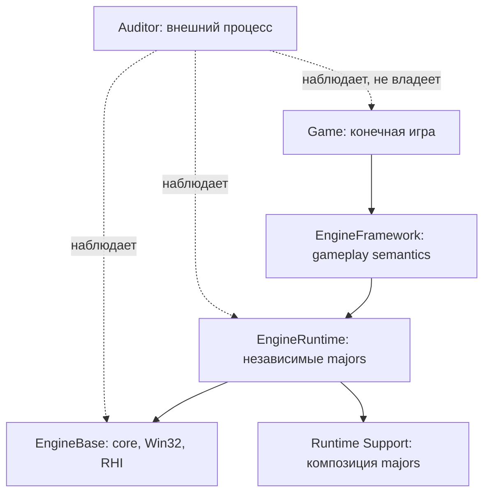

# Epidemic Engine | стартовая страница

Текущий старт новой игры: [принципы и маршрут ИИ-агента](../game-authoring.md).
Статусы после аудита Ascent: [TODO](../maintenance-todo.md),
[архив отчётов](../Reports/Archive/README.md). Следующее описание снимка относится
к историческим API-страницам, а не к новым руководствам ветки 1.0.1.

> [!important] Область документации
> Снимок исходников из архива `Epidemic(1).zip`, полученного 10.10.2026. Это автономный справочник для Obsidian. Структура, CMake и публичные объявления проверены по файлам архива. Сборка и выполнение Windows-тестов в процессе подготовки Vault не проводились. Прохождение тестов в предыдущих отчётах не переносится на этот снимок автоматически.

Практические руководства дополнены 19.10.2026 по текущей ветке SDK 1.0.1 и
опыту ASCENT 0.1.19d: [[03 Работа с движком/Практическая интеграция игры]] и
[[08 Auditor/Запуск Auditor]]. Это обновление не пересоздаёт исторические
API-снимки: актуальные объявления находятся в исходном репозитории.

## Начать работу

1. [[01 Путеводители/Маршруты чтения|Выберите маршрут чтения]]: изучить архитектуру, собрать движок или расширить его.
2. [[03 Работа с движком/Установка и требования|Подготовьте Windows 11 и инструменты]].
3. [[03 Работа с движком/Сборка и конфигурации|Соберите проект]], затем [[03 Работа с движком/Тесты и запуск|выполните тесты]].
4. [[02 Архитектура/Слои и направления зависимостей|Разберитесь в границах слоёв]].
5. [[07 Сценарии/Подключение движка к приложению|Разберите composition root и frame loop]].

Для небольшой 2D-игры через установленный SDK используйте
[[03 Работа с движком/Практическая интеграция игры|Presentation/Session и MinimalGame]].
Низкоуровневый маршрут EngineBase/Runtime нужен при собственной композиции сервисов.

## Карта знаний

| Раздел | Назначение |
| --- | --- |
| [[01 Путеводители/Маршруты чтения]] | Последовательное изучение по задаче |
| [[02 Архитектура/Слои и направления зависимостей]] | Зависимости, границы, данные и lifecycle |
| [[03 Работа с движком/Сборка и конфигурации]] | Сборка, запуск, ошибки Windows и CI |
| [[04 EngineBase/Обзор EngineBase]] | Сервисы, Win32, ввод, RHI и core |
| [[05 EngineRuntime/Обзор EngineRuntime]] | Runtime majors, их contracts и Support |
| [[06 EngineFramework/Обзор EngineFramework]] | Gameplay owners, интеграция, SaveGame |
| [[07 Сценарии/Сценарии и потоки данных]] | Практические операции и маршруты данных |
| [[08 Auditor/Обзор Auditor]] | Внешний наблюдатель, метрики, evidence |
| [[09 Качество и статус/Текущее состояние и границы достоверности]] | Статус freeze, тестов, незавершённые задачи |
| [[10 Разработка/Как изменять движок]] | Инструкция для разработчика и агента |
| [[11 API/Индекс API]] | Публичные C++ headers с объявлениями и полным снимком содержимого |
| [[12 Справочник/Термины]] | Термины, состояния, исходные документы |

## Ключевая схема

Обратите внимание: на схеме стрелка из Runtime к Support означает использование слоя композиции на уровне приложения. `Support` располагается внутри EngineRuntime, а не под ним. В production коде прямые зависимости между Runtime majors запрещены. [[02 Архитектура/Runtime и Support|Подробная схема]].

## Навигация

Открыть встроенную схему в Obsidian: [[Карта движка.canvas]]. Все заметки имеют сквозные ссылки на исходную документацию, source-path и/или снимки заголовков. Оригинальный C++ репозиторий в Vault не включён. Для изменений нужен отдельный исходный проект.

## Как работать с подробными страницами

Для исследуемой подсистемы откройте её страницу `Модуль ...`, прочитайте раздел контрактов и инвариантов, затем сопоставьте конкретную операцию из секции операций с public header в `11 API`. Дальше идите по `Карта реализации и отладочные точки`, `Диагностические коды ошибок` и `Конкретные тестовые якоря`. Там, где показаны фрагменты кода, указан source file и строка исходного архива.

Для практического использования начните с [[02 Архитектура/Жизненный цикл]], [[02 Архитектура/Runtime и Support]], [[07 Сценарии/Runtime кадр]] и [[07 Сценарии/World Scene Physics]]. Для отказов и проверок смотрите [[02 Архитектура/Ошибки и инварианты]], [[03 Работа с движком/Тесты и запуск]] и [[08 Auditor/Понимание evidence]].

Справочник обновлён в глубину без изменения каталога тем или числа заметок. Детали точности и ограничений автоматической индексации описаны в [[12 Справочник/Ограничения справочника]].
