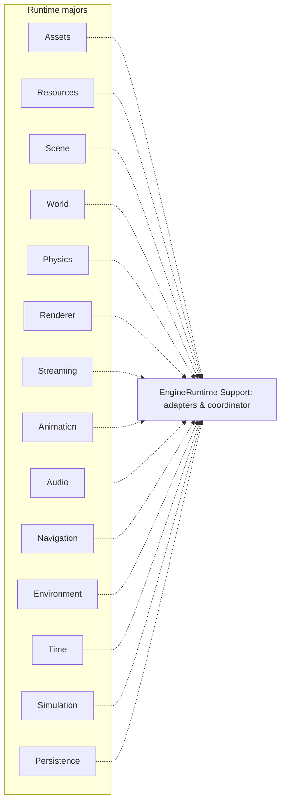
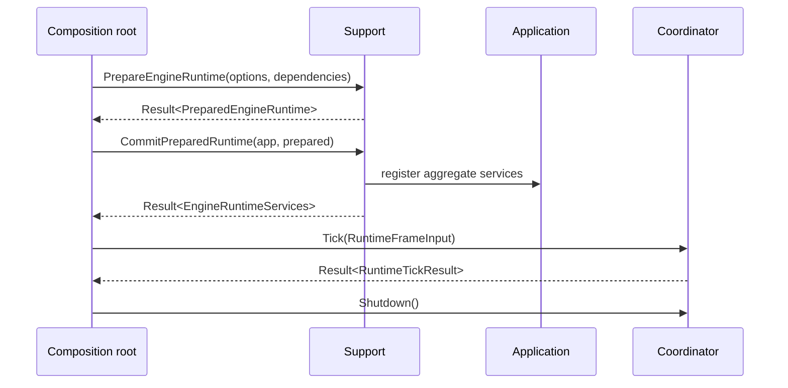

# Runtime: независимые majors и Support

`EngineRuntime` разделён на 16 engine majors плюс композиционный `Support`. `RuntimeFoundation` служит общей основой для majors. Прямые include/link между остальными majors запрещены (подробности задаёт architecture checker).

Стандартные мосты, выраженные через ports/adapters: Scene→Renderer; Resources→Renderer; Scene↔Physics; Resources→Animation→Renderer; Resources→Audio; World+Resources+Persistence→Streaming; Environment→Navigation; Time→Simulation→commit target. Это **логические потоки**, а не разрешение на прямое связывание majors.

`PrepareEngineRuntime()` подготавливает bundle и adapters до регистрации в `Application`; `CommitPreparedRuntime()` публикует подготовленную композицию. `RegisterDefaultEngineRuntime()` предоставляет сокращённый путь. Runtime lifecycle координируется `IEngineRuntimeCoordinator`.

[[05 EngineRuntime/Модуль Support|Описание Support]] · [[07 Сценарии/Runtime кадр|Последовательность Tick]] · [[11 API/EngineRuntime/Support/runtime_support.h|Публичный контракт]].

---

## Почему Support является обязательной границей интеграции

Runtime majors намеренно не должны линковаться напрямую на другие majors там, где связь можно выразить через нейтральные порты. `EngineRuntime/Support` создаёт адаптеры, удерживает их ownership и связывает сервисные интерфейсы. Поэтому для интеграции Scene с Physics, Animation с Renderer, World/Resources/Persistence со Streaming используются `RuntimeIntegrationServices`, а не compile-time include произвольного соседнего модуля.

`EngineRuntimeServices` предоставляет bundles конкретных включённых подсистем, `integrations` и `coordinator`. `EngineRuntimeOptions` задаёт switches для majors, их options и `RuntimeProfile`. В `Reference` существуют упрощённые backends; в `Production` требуются настоящие внешние реализации ключевых портов Renderer, Physics, Navigation, Animation, Audio и Simulation. Отсутствие обязательной Production dependency должно быть выявлено до публикации сервисов.

## Проверяемая цепочка и атомарность

Вызов `PrepareEngineRuntime` не мутирует `Application`. Для стандартного Streaming на Production подаётся `IChunkStreamingManifestSource`. Ручная замена составных roles должна быть полной, например Navigation требует согласованные `data_source`, `cost_provider`, `obstacle_source`, а Physics требует пару transform source и sink. Частично установленный набор будет нарушать ownership, поэтому он недопустим по документированному контракту.

Порядок фаз и retry рассматриваются в [[07 Сценарии/Runtime кадр]]. Исходная форма вызовов: `Documentation/EngineRuntime/using_engineruntime.md` и `EngineRuntime/Support/include/Epidemic/Runtime/Support/runtime_support.h`.
