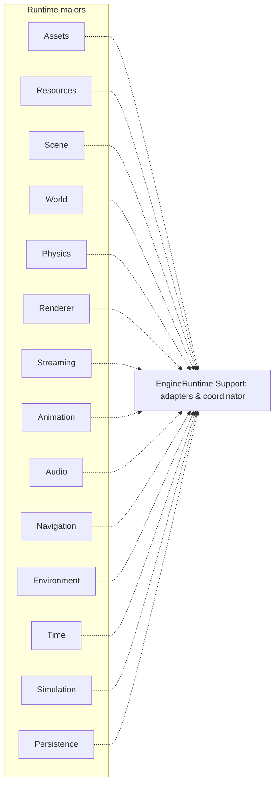

# Runtime: независимые majors и Support

`EngineRuntime` разделён на 16 engine majors плюс композиционный `Support`. `RuntimeFoundation` служит общей основой для majors. Прямые include/link между остальными majors запрещены (подробности задаёт architecture checker).

Стандартные мосты, выраженные через ports/adapters: Scene→Renderer; Resources→Renderer; Scene↔Physics; Resources→Animation→Renderer; Resources→Audio; World+Resources+Persistence→Streaming; Environment→Navigation; Time→Simulation→commit target. Это **логические потоки**, а не разрешение на прямое связывание majors.

`PrepareEngineRuntime()` подготавливает bundle и adapters до регистрации в `Application`; `CommitPreparedRuntime()` публикует подготовленную композицию. `RegisterDefaultEngineRuntime()` предоставляет сокращённый путь. Runtime lifecycle координируется `IEngineRuntimeCoordinator`.

[[05 EngineRuntime/Модуль Support|Описание Support]] · [[07 Сценарии/Runtime кадр|Последовательность Tick]] · [[11 API/EngineRuntime/Support/runtime_support.h|Публичный контракт]].
