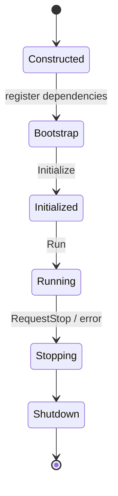

# Application и жизненный цикл

Владелец composition root регистрирует сервисы до initialization. EngineBase не сканирует проект автоматически.

Диаграмма иллюстрирует типичную последовательность использования `Application`, а не буквальное перечисление enum значений. Точные переходы, ошибки и frame phases смотрите в [[11 API/EngineBase/Core/application.h]] и [[11 API/EngineBase/Core/frame_phase.h]].

Регистрация EngineBase services делается через `RegisterEngineBase()`. Win32 runtime, MainWindow, input frame loop и graphics runtime регистрируются отдельно по необходимости. Для дополнительной frame phase используют `Application::AddFramePhaseHandler()`.

Runtime coordinator имеет отдельный lifecycle и явный `Shutdown()`. Начало остановки запрещает приём новых кадров. Cleanup best-effort с учётом ownership и retry при неудачных release (см. [[05 EngineRuntime/Модуль Support]]).

Практика: [[07 Сценарии/Подключение движка к приложению]] и [[90 Первоисточники/Documentation/EngineBase/using_enginebase|using_enginebase.md]].
