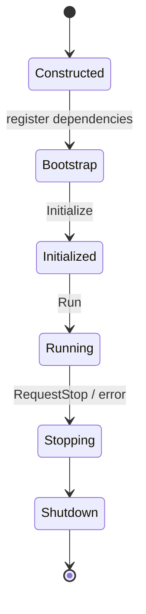

# Application и жизненный цикл

Владелец composition root регистрирует сервисы до initialization. EngineBase не сканирует проект автоматически.



Диаграмма иллюстрирует типичную последовательность использования `Application`, а не буквальное перечисление enum значений. Точные переходы, ошибки и frame phases смотрите в [[11 API/EngineBase/Core/application.h]] и [[11 API/EngineBase/Core/frame_phase.h]].

Регистрация EngineBase services делается через `RegisterEngineBase()`. Win32 runtime, MainWindow, input frame loop и graphics runtime регистрируются отдельно по необходимости. Для дополнительной frame phase используют `Application::AddFramePhaseHandler()`.

Runtime coordinator имеет отдельный lifecycle и явный `Shutdown()`. Начало остановки запрещает приём новых кадров. Cleanup best-effort с учётом ownership и retry при неудачных release (см. [[05 EngineRuntime/Модуль Support]]).

Практика: [[07 Сценарии/Подключение движка к приложению]] и [[90 Первоисточники/Documentation/EngineBase/using_enginebase|using_enginebase.md]].

---

## Порядок вызовов и условия переходов

`Application` в `EngineBase/Core/include/Epidemic/Core/application.h` хранит `ServiceContainer`, `ModuleRegistry`, таблицу обработчиков каждой `FramePhase`, состояние остановки, счётчик выполненных кадров и временные метки. Объект не создаёт окно, графический backend, ввод или Gameplay services автоматически. Эти зависимости добавляет вызывающий composition root.

Для обычного запуска последовательность такова: создать `Application`; зарегистрировать требуемые реализации интерфейсов и модули; `Bootstrap()`; `Initialize()`; затем `Tick()` либо `Run()`; в конце `Shutdown()`. `Run()` содержит повторение кадров до `RequestStop()` или `frame_limit`. `Tick()` отвечает ровно за один кадр. `AddFramePhaseHandler` привязывает внешний callback к конкретной фазе; `AddFramePhaseHandlersAtomic` добавляет пачку обработчиков после подготовки candidate table. Не регистрируйте новые сервисы после закрытия контейнера в `Initialize()`.

```cpp
// Фрагмент управления состоянием Application, без платформенных зависимостей.
epidemic::core::Application app({.application_name = "Demo", .frame_limit = 120});
// Здесь регистрируют нужные EngineBase services и модули.
if (app.Bootstrap() != 0) return 1;
if (app.Initialize() != 0) return 2;
const int exit_code = app.Run();
const int shutdown_code = app.Shutdown();
return exit_code != 0 ? exit_code : shutdown_code;
```

Пример предполагает, что необходимые сервисы уже зарегистрированы, и не является полностью самостоятельным `main()`. `FrameContext` создаёт сама `Application`. Не вычисляйте индекс или время кадра вручную в обработчике. Callback с borrowed references безопасен лишь пока владелец этих ссылок жив и в допустимой фазе. Внутренний `State::Failed` предусмотрен, поэтому успешная конструкция объекта не означает успешную инициализацию.

## Отдельный жизненный цикл Runtime

`IEngineRuntimeCoordinator` управляет набором Runtime majors независимо от `Application::Shutdown`. Runtime создаётся в два шага: `PrepareEngineRuntime()` строит candidate без изменения `Application`, `CommitPreparedRuntime()` публикует единый сервисный aggregate. Созданный coordinator принимает `RuntimeFrameInput`, возвращает `RuntimeTickResult` и прекращает приём кадров после начала `Shutdown()`. При неудачном освобождении Runtime может потребоваться повторный `Shutdown()`; не уничтожайте интеграционные lease owners до завершения этой процедуры.

Точки для отладки: `EngineBase/Core/src/application.cpp`, `EngineRuntime/Support/src/runtime_support.cpp`; спецификация [[05 EngineRuntime/Модуль Support]].
