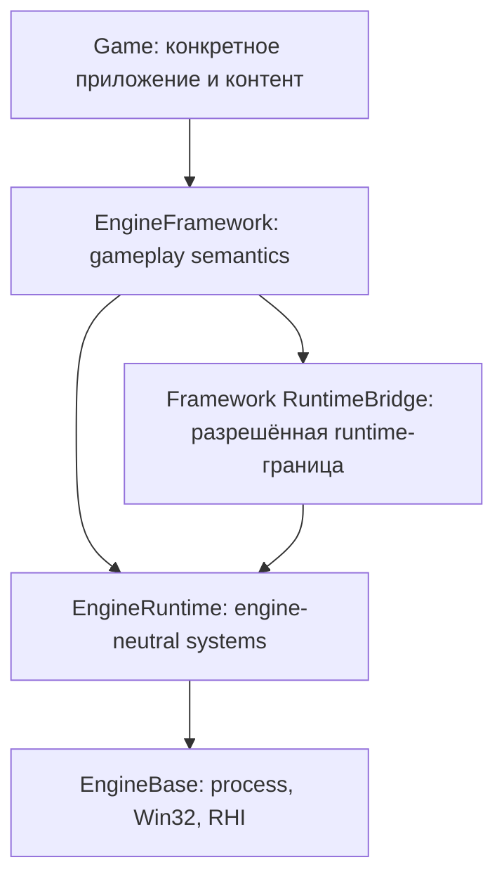

# Слои и направления зависимостей

Основной архитектурный договор: `Game → EngineFramework → EngineRuntime → EngineBase`. Нижний слой не зависит от верхнего. Репозиторий на данном снимке содержит `EngineBase`, `EngineRuntime`, `EngineFramework`; готового production каталога `Game/` в корне нет.

### EngineBase

Основа C++23 исполнения: common types, memory/diagnostics, `Application`, services/modules lifecycle, scheduler, main-thread dispatcher, Win32 windows/input, базовый RHI и D3D11. Не владеет инвентарём, World, Scene, physics или Renderer. [[04 EngineBase/Обзор EngineBase]].

### EngineRuntime

Нейтральные к игровым правилам системы: world/scene, ресурсный цикл, загрузка, симуляция, рендер, физика, звук и др. Каждый major имеет собственный public contract, а технические связи собираются в `EngineRuntime/Support`. [[05 EngineRuntime/Обзор EngineRuntime]].

### EngineFramework

Владельцы gameplay state, общие игровые понятия, интеграции, порт между gameplay world и допустимыми runtime-контрактами. Не должен превращаться в платформенный код. [[06 EngineFramework/Обзор EngineFramework]].

### Game

Ожидаемая точка сборки конкретной игры: состав сервисов и runtime, content, rules, UI/game loop. Конкретного `Game/` в переданном архиве нет, поэтому готовый production startup приложения не заявлен.

Подробные исключения и централизованные allowlists: [[02 Архитектура/Правила архитектурного freeze]], оригинальная документация: [[90 Первоисточники/Documentation/architecture|architecture.md]].

---

## Как читать dependency graph

Направление compile-time dependency и runtime dataflow не обязано совпадать. Например, Physics может передать результат Scene через интерфейс интегратора Runtime Support, не создавая `Physics -> Scene` link. Для архитектурного анализа разделяйте target_link_libraries, include edges, adapter bindings и фактические операции на кадре.
