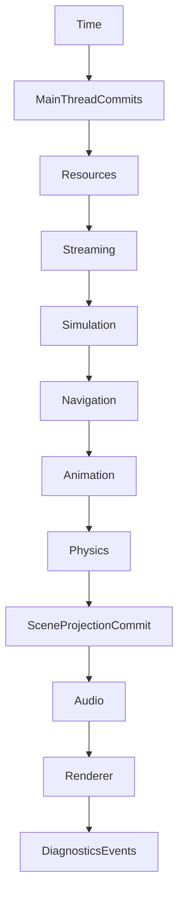

# Последовательность Runtime кадра

Стандартный coordinator, описанный в `Documentation/EngineRuntime/modules/support.md`, исполняет следующий порядок:

Кадр получает `RuntimeFrameInput` с `real_delta`, бюджетами загрузки, стриминга, навигации и анимации. Game delta берётся из `Time`, и не вычисляется произвольно в каждом major. `Tick()` возвращает `RuntimeTickResult`; `executed_steps` содержит реально принятые фазы, `failures` локальные recoverable failures.

При позднем прерывании Tick coordinator сохраняет pending-frame state. Повтор с тем же input может продолжить незавершённый suffix, другой input до reconciliation отклоняется. Не вызывайте Tick с новым временем, если предыдущий кадр требует retry.

Результат domain sim commits ограничивается frame budget. Обновление объектов на главном потоке выполняется на designated phase; не модифицируйте authoritative state из произвольного worker callback.

[[05 EngineRuntime/Модуль Support]] · [[11 API/EngineRuntime/Support/runtime_support.h]].
