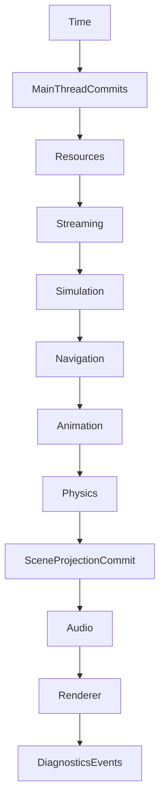

# Последовательность Runtime кадра

Стандартный coordinator, описанный в `Documentation/EngineRuntime/modules/support.md`, исполняет следующий порядок:



Кадр получает `RuntimeFrameInput` с `real_delta`, бюджетами загрузки, стриминга, навигации и анимации. Game delta берётся из `Time`, и не вычисляется произвольно в каждом major. `Tick()` возвращает `RuntimeTickResult`; `executed_steps` содержит реально принятые фазы, `failures` локальные recoverable failures.

При позднем прерывании Tick coordinator сохраняет pending-frame state. Повтор с тем же input может продолжить незавершённый suffix, другой input до reconciliation отклоняется. Не вызывайте Tick с новым временем, если предыдущий кадр требует retry.

Результат domain sim commits ограничивается frame budget. Обновление объектов на главном потоке выполняется на designated phase; не модифицируйте authoritative state из произвольного worker callback.

[[05 EngineRuntime/Модуль Support]] · [[11 API/EngineRuntime/Support/runtime_support.h]].

---

## Реальная транзакционная модель кадра

Кадр передаётся как `RuntimeFrameInput`: `real_delta`, `resource_budget`, `streaming_budget`, `navigation_budget`, `max_animators`, `max_simulation_commits`. `Tick()` возвращает `RuntimeTickResult` с `time`, `executed_steps` и `failures`. Список `executed_steps` отражает принятую работу, поэтому логируйте его отдельно от перечня ошибок. Game delta извлекается из `TimeAdvanceResult`, а не из самостоятельного вычисления в Physics/Animation.

`MainThreadCommits` исполняется после `Time`. Это единственная разрешённая стандартной последовательностью фаза публикации подготовленных main-thread результатов. `Physics` передаёт world transform writes в `ISceneProjectionQueue`; только `SceneProjectionCommit` применяет их к Scene. `DiagnosticsEvents` строит отсоединённый batch контактов Physics, событий Animation/Audio и failure records. `IRuntimeEventSink::Publish` либо принимает batch целиком, либо сообщает отказ без внешнего commit. Источники событий очищаются после подтверждённой публикации.

```cpp
epidemic::runtime::RuntimeFrameInput frame{};
frame.real_delta = real_delta; // Значение от стабильного frame clock.
frame.max_simulation_commits = 64;
const auto tick = services.coordinator->Tick(frame);
if (!tick)
{
    // Если получен runtime_support.frame_retry_required, требуется
    // повтор именно сохраненного input. Другой input до reconciliation запрещён.
    return;
}
for (const auto& phase : tick.Value().executed_steps)
{
    // Записать действительно выполненную phase.
}
for (const auto& problem : tick.Value().failures)
{
    // Логировать phase и Error, определить политику восстановления.
}
```

## Повтор прерванного кадра

При позднем allocation failure coordinator сохраняет pending state кадра и подтверждённый cursor. Повтор с **тем же** `RuntimeFrameInput` продолжает suffix, не повторяя Time, Streaming и Simulation commits, уже принятые ранее. Отличающийся input в этом состоянии отклоняется кодом `runtime_support.frame_retry_required`. Это важно при интеграции с main game loop: нельзя механически вызывать `Tick(new_delta)` после любого провала.

Контракт: `EngineRuntime/Support/src/runtime_support.cpp`, `Documentation/EngineRuntime/modules/support.md`.
