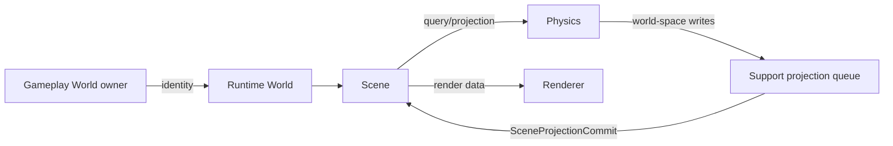

# Runtime World, Scene, Physics

Runtime World хранит логические свойства размещения: region/chunk, reality, residency, persistence tier. Scene является владельцем hierarchy и spatial presentation. Physics имеет simulation-specific representation.

Диаграмма показывает допустимые направления данных через ports/adapters. Прямые compile-time зависимости `Physics`→`Scene` и `Scene`→`Renderer` запрещены. `World` применяется через revisioned commands; `expected_revision == 0` не является wildcard. Physics transforms сохраняют ownership до commit phase, а Scene пересчитывает local transform относительно parent.

[[05 EngineRuntime/Модуль World]] · [[05 EngineRuntime/Модуль Scene]] · [[05 EngineRuntime/Модуль Physics]] · [[05 EngineRuntime/Модуль Support]].
