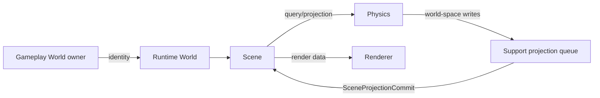

# Runtime World, Scene, Physics

Runtime World хранит логические свойства размещения: region/chunk, reality, residency, persistence tier. Scene является владельцем hierarchy и spatial presentation. Physics имеет simulation-specific representation.



Диаграмма показывает допустимые направления данных через ports/adapters. Прямые compile-time зависимости `Physics`→`Scene` и `Scene`→`Renderer` запрещены. `World` применяется через revisioned commands; `expected_revision == 0` не является wildcard. Physics transforms сохраняют ownership до commit phase, а Scene пересчитывает local transform относительно parent.

[[05 EngineRuntime/Модуль World]] · [[05 EngineRuntime/Модуль Scene]] · [[05 EngineRuntime/Модуль Physics]] · [[05 EngineRuntime/Модуль Support]].

---

## Последовательность согласования пространственного состояния

Gameplay owner создаёт доменный объект и держит его семантический ID. Runtime World представляет размещение и режим materialization; Scene создаёт transient `SceneNodeId`, хранит parent/child, локальную и мировую TRS, bounds и visibility. Physics работает с собственным backend representation. Их согласование выполняется через Support adapters, а не прямыми ссылками на соседние реализации.

```cpp
// Укороченный фрагмент работы с уже полученным bundle Scene.
const auto created = runtime.scene->nodes->CreateNode();
if (!created) return;
const auto id = created.Value();
const auto snapshot = runtime.scene->nodes->GetNode(id);
if (!snapshot) return;
// Менять parent/transform следует через соответствующие интерфейсы registry.
```

`ReparentMode::KeepWorld` сохраняет observable world transform только если world-to-local roundtrip проходит preflight; невозможный TRS даёт `scene.unrepresentable_world_transform` без mutation. `KeepLocal` сохраняет local transform, изменяя world result по иерархии. Создание цикла запрещено. На failed mutator предыдущие child lists и revision не должны измениться. Сцена вычисляет world AABB из восьми трансформированных corners и поддерживает nonuniform/negative scale. Пространственные queries возвращают visible nodes с bounds в стабильном порядке `SceneNodeId`.

`SceneSnapshot` служит detached observation, а не долговечным SaveGame. После загрузки игры материализуйте runtime состояние заново через соответствующий reconciliation path. Непосредственное сохранение внутренностей scene implementation нарушит ownership и версионирование.

Якоря: `EngineRuntime/Scene/src/scene_runtime_impl.cpp` и `EngineRuntime/Scene/tests/scene_tests.cpp` (`TestHierarchyAttachDetachAndCycleReject`, `TestSetWorldTransformRejectsInvalidWithoutMutation`, `TestRotatedScaledWorldBounds`).
