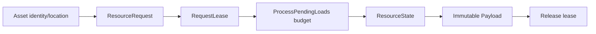

# Assets, Resources и leases

`Assets` отвечает за identity/location/metadata, `Resources` за загрузку payload и lifetime. Это разные owners. `ResourceHandle` не означает право освобождения. `ResourceLease` соответствует владельцу, который обязан завершить lease lifecycle.



Из `using_engineruntime.md`:

```cpp
ResourceRequest request{};
request.resource_id = resource_id;
request.type = resource_type;
auto lease_result = runtime.resources->manager->RequestLease(request);
if (!lease_result) {
    return lease_result.GetError();
}
ResourceLease lease = lease_result.Value();
// ProcessPendingLoads(...), check Ready, use immutable payload.
auto released = runtime.resources->manager->Release(lease);
```

Пример схематичен, локальная обработка failure и корректный typed return должны соответствовать конкретной функции. В adapters освобождение может требовать retry при ошибке; потеря lease при failed release считается нарушением ownership.

[[05 EngineRuntime/Модуль Assets]] · [[05 EngineRuntime/Модуль Resources]] · [[90 Первоисточники/Documentation/EngineRuntime/using_engineruntime|Полный источник]].
