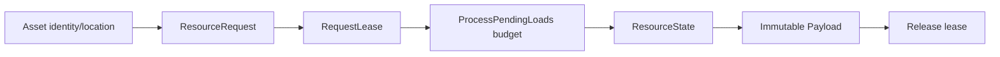

# Assets, Resources и leases

`Assets` отвечает за identity/location/metadata, `Resources` за загрузку payload и lifetime. Это разные owners. `ResourceHandle` не означает право освобождения. `ResourceLease` соответствует владельцу, который обязан завершить lease lifecycle.



Из `using_engineruntime.md`:

```cpp
ResourceRequest request{};
request.resource_id = resource_id;
request.type = resource_type;
auto lease_result = runtime.resources->manager->RequestLease(request);
if (!lease_result) {
    return lease_result.GetError();
}
ResourceLease lease = lease_result.Value();
// ProcessPendingLoads(...), check Ready, use immutable payload.
auto released = runtime.resources->manager->Release(lease);
```

Пример схематичен, локальная обработка failure и корректный typed return должны соответствовать конкретной функции. В adapters освобождение может требовать retry при ошибке; потеря lease при failed release считается нарушением ownership.

[[05 EngineRuntime/Модуль Assets]] · [[05 EngineRuntime/Модуль Resources]] · [[90 Первоисточники/Documentation/EngineRuntime/using_engineruntime|Полный источник]].

---

## Жизненный цикл выдачи lease

`Assets` отвечает за идентификаторы, местоположение и metadata, `Resources` за фактический загруженный payload. Взаимозаменять их нельзя. `ResourceRequest` описывает запрос; `RequestLease()` принимает ownership для потребителя и возвращает `ResourceLease`. Подготовка выполняется с кадровым бюджетом через `ProcessPendingLoads`. Читающий код должен различать ещё не готовый, готовый и неуспешный ресурс. Удержание raw payload pointer после release lease запрещено без отдельной документированной гарантии lifetime.

```cpp
auto acquired = runtime.resources->manager->RequestLease(request);
if (!acquired)
{
    // Error: запрос не принят, lease не принадлежит вызывающему.
    return;
}
auto lease = acquired.Value();
// Дождаться готовности в штатном update, проверить результат загрузки.
auto released = runtime.resources->manager->Release(lease);
if (!released)
{
    // Не забывайте ownership: требуется retry или корректный cleanup владельца.
}
```

Стандартные adapters Animation/Audio в Runtime Support имеют отдельную двухэтапную передачу lease. Сначала создаётся готовое место для ownership, затем выполняется request. При animation descriptor copy ресурс может быть отпущен; у Audio lease остаётся у clip/voice consumer до освобождения. Адаптер обязан сохранить запись для retry, если release не удался. Простое уничтожение wrapper без контроля cleanup создаёт утечку или потерю ownership.

Проверяйте на отдельных сценариях invalid request, отказ allocator перед публикацией slot, exception от внешнего ResourceManager и repeated shutdown после failed release. Модульные контракты: [[05 EngineRuntime/Модуль Resources]] и [[05 EngineRuntime/Модуль Support]].
