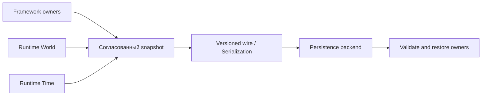

# Сохранение, восстановление и детерминизм

Сохранение затрагивает несколько отдельных владельцев: Runtime Persistence/Serialization, Runtime World/Time и gameplay SaveGame/World/Owners. Нельзя считать их одним объектом состояния или сохранять случайный набор derived caches как authoritative.

`EngineRuntime/Support` имеет отдельные функции file-backed time checkpoint и persistence backend. В их комментарии прямо указано, что эти операции сами по себе **не устанавливают cross-plane consistent save point** (M5.3). Для целостного сохранения используйте контракт владельцев и интеграционные gates, а не только отдельную запись файла.

В Goal 5 присутствуют отдельные документы participants и save generation: [[90 Первоисточники/Documentation/EngineFramework/goal5_participants]] и [[90 Первоисточники/Documentation/EngineFramework/goal5_save_generation]]. Gameplay SaveGame имеет собственные wire/participant contracts.

Рядом с save проверяйте deterministic replay: идентичные входы, порядок, seed/clock, длительность, versions, epoch/generation. Точные критерии задаются тестами `Tests/Truth` и milestone evidence, а не общим пожеланием «детерминированности».

[[06 EngineFramework/Модуль SaveGame]] · [[05 EngineRuntime/Модуль Persistence]] · [[05 EngineRuntime/Модуль Serialization]].

---

## Различие checkpoint плоскостей и согласованного SaveGame

У Runtime Time и Persistence есть независимые долговечные границы с собственными версиями и правилами записи. В `runtime_support.h` прямо указано, что эти операции сами по себе не образуют cross-plane consistent save point (M5.3). Для новых хранилищ отсутствующий файл является ошибкой: сначала явно инициализируйте backend пустым snapshot через предусмотренный контракт. Чтение «не найдено» нельзя автоматически считать корректным пустым миром.

Framework `SaveGame` должен собирать согласованное поколение данных, покрывающее authoritative state нужных владельцев, и подтверждать его атомарно. Transient caches Scene, renderer state и pending callbacks не должны произвольно попадать в долговечную семантическую модель. После загрузки Runtime materialization создаётся через восстановление и reconciliation.

## Критерии детерминизма

Сохраните seed и семантические входы. Проверяйте упорядочивание там, где C++ unordered containers могут менять порядок iteration. Повтор snapshot->restore->snapshot должен сохранять контрактные генераторы ID, revisions, cursors, canonical serialization. Негативные тесты обязаны покрывать invalid version, повреждённый payload, partial file write, ошибку во время restore и независимость старого live state до публикации нового состояния.

Для отладки сравнивайте не байты случайно сериализованной `unordered_map`, а задокументированное canonical representation и проверенные идентификаторы. Источники: `Documentation/EngineFramework/goal5_save_generation.md`, `EngineRuntime/Support/include/Epidemic/Runtime/Support/runtime_support.h`.
