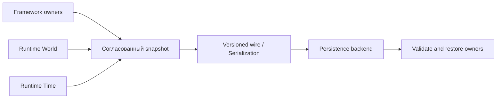

# Сохранение, восстановление и детерминизм

Сохранение затрагивает несколько отдельных владельцев: Runtime Persistence/Serialization, Runtime World/Time и gameplay SaveGame/World/Owners. Нельзя считать их одним объектом состояния или сохранять случайный набор derived caches как authoritative.

`EngineRuntime/Support` имеет отдельные функции file-backed time checkpoint и persistence backend. В их комментарии прямо указано, что эти операции сами по себе **не устанавливают cross-plane consistent save point** (M5.3). Для целостного сохранения используйте контракт владельцев и интеграционные gates, а не только отдельную запись файла.

В Goal 5 присутствуют отдельные документы participants и save generation: [[90 Первоисточники/Documentation/EngineFramework/goal5_participants]] и [[90 Первоисточники/Documentation/EngineFramework/goal5_save_generation]]. Gameplay SaveGame имеет собственные wire/participant contracts.

Рядом с save проверяйте deterministic replay: идентичные входы, порядок, seed/clock, длительность, versions, epoch/generation. Точные критерии задаются тестами `Tests/Truth` и milestone evidence, а не общим пожеланием «детерминированности».

[[06 EngineFramework/Модуль SaveGame]] · [[05 EngineRuntime/Модуль Persistence]] · [[05 EngineRuntime/Модуль Serialization]].
