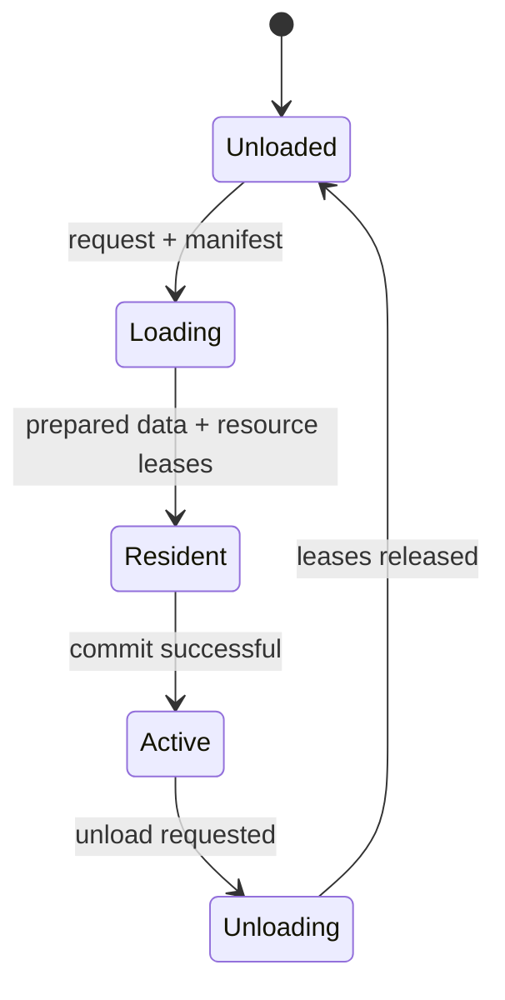

# Streaming: резидентность чанков

Streaming изменяет присутствие чанков по бюджету кадра и согласует World, ResourceLease и Persistence через стандартный Support adapter. В Production стандартный adapter требует `IChunkStreamingManifestSource` либо полноценный custom override всех integration roles.

Эти имена отображают документированную happy-path последовательность стандартного adapter; реальные guards, ошибки и альтернативные пути сверяйте с [[05 EngineRuntime/Модуль Streaming]]. После failed cleanup lease ownership сохраняется для retry. Во время загрузки prepared persistence snapshot может быть доступен через `IStreamingPreparedChunkDataQuery`.

[[11 API/EngineRuntime/Streaming/streaming_runtime.h]] · [[90 Первоисточники/Documentation/EngineRuntime/modules/support|Исходный контракт Support]].

---

## Что делает стандартный adapter

Support получает manifest через `IChunkStreamingManifestSource` и использует World, Resources и Persistence для согласования загружаемого чанка. После `Unloaded -> Loading` производится detached read persistence override и acquisition нужных resource leases. Chunk становится `Resident/Active` только после успешной подготовки и commit. Пока загружен, подготовленное persistence представление может читаться через `IStreamingPreparedChunkDataQuery`.

При выгрузке переход начинается с `Unloading`, затем освобождаются active leases; только после подтверждения полного освобождения устанавливается `Unloaded`. Failed release нельзя трактовать как успешную выгрузку или просто выкидывать lease из индекса владельца. Такой сценарий должен покрываться fault-injection, иначе возможны утечки и расхождение residency state.

## Диагностика зависшего чанка

Проверяйте последовательно наличие manifest, корректность identifiers и revision, загрузочный budget, результаты запросов в Resources, подготовленный Persistence snapshot, chunk state, количество удержанных leases и очередь повторного cleanup. Проблема в загрузке payload и проблема в авторитетной commit phase имеют разные owners и различный recovery.

В Production стандартный адаптер требует реального manifest provider. Partial replacement только одного из Streaming core roles отклоняется, чтобы не смешивать разные реализации ownership в одной транзакции. Основной код связи находится в `EngineRuntime/Support/src/runtime_support.cpp`, а контракты Streaming в [[05 EngineRuntime/Модуль Streaming]].
