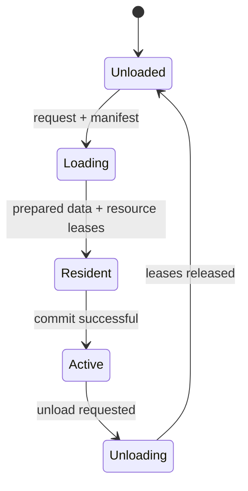

# Streaming: резидентность чанков

Streaming изменяет присутствие чанков по бюджету кадра и согласует World, ResourceLease и Persistence через стандартный Support adapter. В Production стандартный adapter требует `IChunkStreamingManifestSource` либо полноценный custom override всех integration roles.

Эти имена отображают документированную happy-path последовательность стандартного adapter; реальные guards, ошибки и альтернативные пути сверяйте с [[05 EngineRuntime/Модуль Streaming]]. После failed cleanup lease ownership сохраняется для retry. Во время загрузки prepared persistence snapshot может быть доступен через `IStreamingPreparedChunkDataQuery`.

[[11 API/EngineRuntime/Streaming/streaming_runtime.h]] · [[90 Первоисточники/Documentation/EngineRuntime/modules/support|Исходный контракт Support]].
