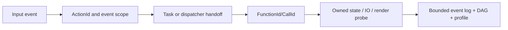

# События, Action и причинные графы

Auditor различает function ENTER/EXIT (compiler/native trace), семантические probe handoffs и внешние process/ETW facts. Action фиксирует bounded correlation chain вокруг заданного события (например, нажатие input в Audit profile); replay evidence можно открыть через Actions/Event Log или CLI.

Это модель корреляции при наличии probes; не каждая стрелка гарантированно наблюдаема, а callback entered не равен успешному commit или GPU completion. Поддерживается rolling capture с ограниченными pre/post окнами. Потерянные records, abort/crash и неполные стековые события помечаются неполными.

Отчёты подготавливаются из проверенных sealed Run; назначение события input через `capture.arm_next_input` и rolling capture через `capture.rolling` описаны в [[90 Первоисточники/.epidemic-auditor/README|актуальном README Auditor]].

---

## Разделение причинной связи и длительности

Function entry/exit interval не обязательно равен CPU-exclusive time, особенно при thread preemption. Причинный граф по correlation IDs не означает порядок всех неинструментированных событий. Native call tree строится лишь для balanced ENTER/EXIT и корректно разрешённых binaries. Для dropped events указывайте gap и `INCOMPLETE`; для отсутствующей записи конкретной категории используйте `UNKNOWN`, не ноль.
