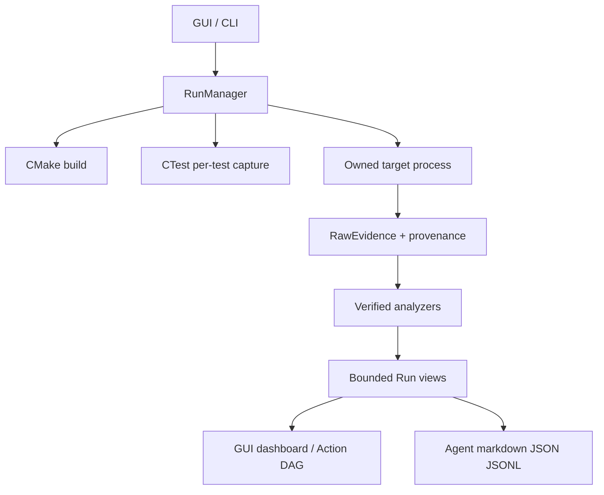

# Epidemic Auditor: внешний наблюдатель

Auditor находится в `.epidemic-auditor/` и собирается независимо от production-кода движка. Через GUI/CLI он выполняет configure/build/CTest/run и собирает evidence: stdout/stderr, дерево процессов и ресурсы ОС, native/probe traces, ETW в поддерживаемых профилях, статические проверки и отчёты для агента.

Точка доверия важна: externally observed facts и declarative `engine_probe` события должны различаться. Успех вспомогательного capture helper не заменяет exit code тестируемого процесса.

Операции запускаются из `Start-Auditor.ps1`, `Run-Auditor.ps1` или `ep_auditor.cli`. Captures принадлежат Run, имеют стабильные идентификаторы и проверяемые ссылки на raw evidence.

**Статус:** текущий архив явно фиксирует MS6 как PARTIALLY COMPLETE и откладывает полную acceptance до MS8 и первой тестовой игры; полные системы и соответствующие физические проверки ещё требуют подтверждения. [[09 Качество и статус/Состояние MS6]].

Исходник: [[90 Первоисточники/.epidemic-auditor/README|README Auditor]] · [[90 Первоисточники/.epidemic-auditor/ARCHITECTURE|архитектура Auditor]] (второй документ частично исторический, при расхождении используйте код и актуальный README).
